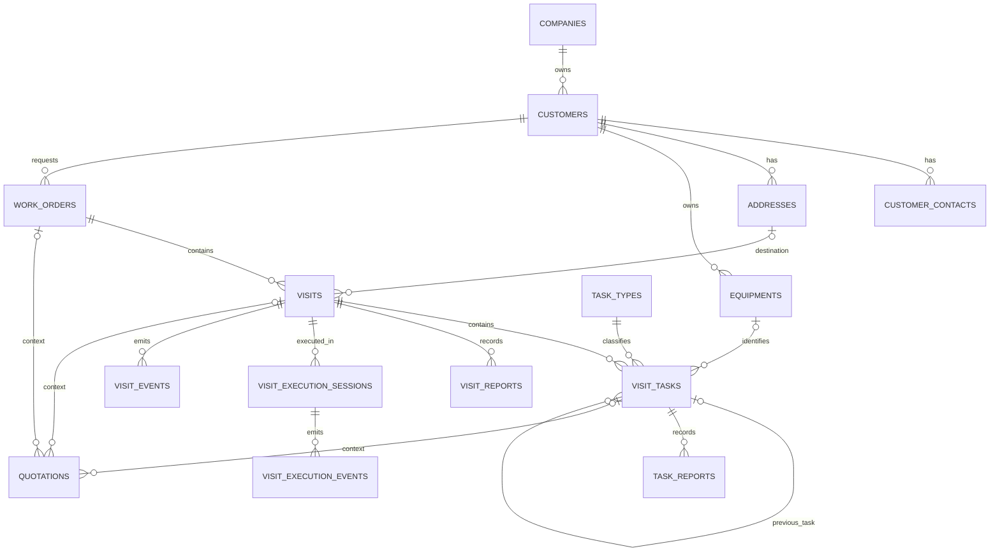
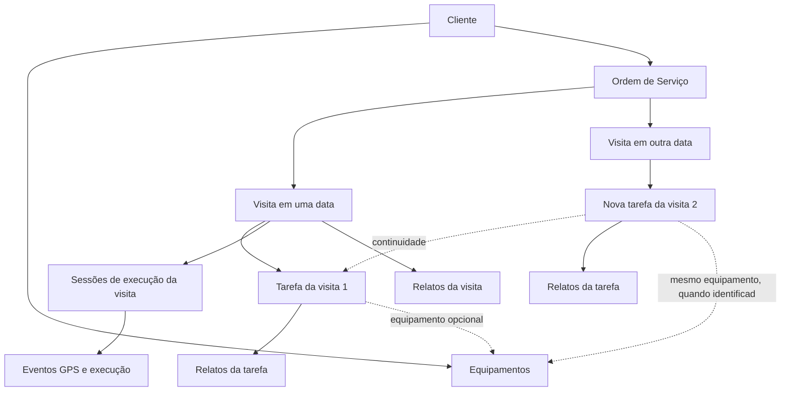

# Modelo lógico de dados e matriz de conformidade — Operação MVP

**Versão:** 0.3.0  
**Data:** 2026-11-08  
**Estado:** proposta técnica para validação; não aprovada como modelo físico  
**Projeto Supabase avaliado:** Winservice — `voaovwphncwbrwtcqnsc`  
**Schema:** `public`

> Este documento traduz o baseline funcional de Operação em uma proposta de modelo lógico e compara essa proposta com o schema efetivamente inspecionado. Não é uma ADR, não autoriza alterações no banco e não representa uma migração pronta para execução. Os nomes de tabelas e colunas propostos são conceituais até aprovação.

## 1. Objetivos e limites

O modelo deve:
- preservar a história completa de cada atendimento na Ordem de Serviço (OS);
- registrar cada comparecimento em uma visita própria;
- registrar tarefas específicas dentro de cada visita, sem status de execução ou conclusão na tarefa;
- relacionar opcionalmente cada tarefa a um equipamento identificado, ainda não identificado ou não aplicável;
- registrar relatos gerais da visita e relatos próprios de cada tarefa;
- registrar períodos de execução em sessões vinculadas à visita, com eventos GPS;
- preservar autoria, versões anteriores e histórico de alterações;
- permitir navegação cliente → equipamento/OS → visita → tarefa → relatos e execução da visita;
- garantir coerência entre empresa, cliente, OS, visita, equipamento e usuários.

Fora do escopo desta proposta: DDL, migrações, políticas RLS, implementação de GPS no aplicativo, contratos de API, workflow n8n e definição completa de todos os estados de visita.

## 2. Decisões funcionais consideradas como entrada

1. A OS preserva o histórico completo do atendimento e pode conter várias visitas.
2. Uma nova data de atendimento gera uma nova visita. Em regra, a nova visita permanece na mesma OS; o técnico poderá optar por criar uma nova OS.
3. Cada visita possui suas próprias tarefas. Uma tarefa não é transferida para outra visita.
4. Se o atendimento continuar em outra data, cria-se nova visita e nova tarefa, normalmente vinculada ao mesmo equipamento e podendo referenciar a tarefa anterior.
5. A tarefa não possui status de execução ou conclusão.
6. Cada tipo de tarefa pode exigir campos, relatos e evidências próprios.
7. A visita precisa ter pelo menos um relato geral ou um relato de alguma tarefa antes de ser encerrada.
8. O equipamento da tarefa é opcional. Deve ser possível registrar equipamento ainda não identificado sem criar um equipamento fictício.
9. A execução temporal é representada por sessões vinculadas à visita, nunca às tarefas. As tarefas não possuem sessão nem estado próprio de execução.
10. O técnico pode ter somente uma visita em execução por vez.
11. O início de uma nova visita finaliza a visita anterior, desde que o técnico registre o relato exigido para a finalização.
12. Ao se afastar 200 metros ou mais do endereço da visita (limiar configurável), a execução da visita é pausada automaticamente.
13. Ao retornar para 50 metros ou menos do endereço da visita (limiar configurável), a execução pausada pode ser retomada automaticamente, desde que a visita ainda esteja apta a continuar.
14. A regra anteriormente registrada de check-in inicial dentro de 50 metros por 5 minutos permanece como requisito a confirmar em conjunto com os novos limiares; não deve ser confundida com a regra de retomada.
15. Somente sessões pausadas podem ser finalizadas automaticamente pelo limite da jornada. A hora efetiva de encerramento é a hora da pausa; coordenadas são as capturadas na pausa. O horário em que o sistema processou o fechamento deve ser armazenado separadamente.
16. A visita finalizada automaticamente pode exigir relato posterior do técnico antes de ele prosseguir no aplicativo ou iniciar novo deslocamento/visita.
17. Reabertura de visita finalizada é exclusiva do técnico dentro de 200 metros do endereço. Gestor e atendente não podem reabrir.
18. Gestor pode editar visita finalizada. Edição por técnico e atendente é configurável pelo gestor.
19. Tipos de tarefa partem de um catálogo global, mas cada empresa poderá editar sua própria versão sem alterar o catálogo global nem as versões das demais empresas.
20. Um orçamento pode estar vinculado a, no máximo, uma entidade operacional: uma OS, uma visita, uma tarefa ou nenhuma delas.
21. A máquina de estados reutilizável mencionada pelo responsável pertence ao módulo Chat. Ela não define nem substitui o ciclo operacional das visitas.
22. Alterações devem preservar dados anteriores e registrar autoria e temporalidade. A arquitetura de histórico imutável descrita adiante é recomendação técnica ainda sujeita a validação.

## 3. Modelo conceitual e cardinalidades

O diagrama é conceitual. As relações opcionais e as restrições multiempresa devem ser formalizadas por chaves compostas e regras adicionais, não apenas pelo desenho.

### Cardinalidades principais

| Relação | Cardinalidade | Regra |
|---|---|---|
| Empresa → clientes | 1:N | Cliente pertence a uma empresa |
| Cliente → equipamentos | 1:N | Equipamento pertence a um cliente |
| Cliente → OS | 1:N | OS pertence a um cliente |
| OS → visitas | 1:N | Visita pertence a uma única OS |
| Visita → tarefas | 1:N | Tarefa pertence a uma única visita |
| Tipo de tarefa → tarefas | 1:N | Toda tarefa possui um tipo |
| Equipamento → tarefas | 1:N | Uma tarefa pode não ter equipamento |
| Tarefa → tarefa anterior | 0..1:N | Uma tarefa pode apontar para uma tarefa anterior; uma tarefa pode originar várias continuidades |
| Visita → relatos | 1:N | Relato geral é opcional individualmente; conjunto deve satisfazer regra mínima de encerramento |
| Tarefa → relatos | 1:N | Uma tarefa pode ter vários relatos |
| Visita → sessões de execução | 1:N | A sessão pertence à visita; tarefas não possuem sessões |
| Sessão da visita → eventos | 1:N | Eventos formam a trilha temporal/GPS da execução da visita |
| OS/visita/tarefa → orçamento | 0..1:N | Cada orçamento pode apontar para no máximo uma dessas entidades, ou nenhuma |

## 4. Entidades lógicas propostas

Os nomes abaixo são sugestões. Não criar essas tabelas antes de aprovar o modelo e conferir convenções do projeto.

### 4.1 Entidades existentes a aproveitar conceitualmente

#### `customers` — clientes
Identidade do cliente e vínculo obrigatório com a empresa. Deve ser a origem do relacionamento com equipamentos e OS.

Campos relevantes existentes: `identifier`, `name`, `cpf_cnpj`, `status`, `created_by`, `updated_by`, `company_identifier`, `created_at`, `updated_at`.

Ajustes a avaliar:
- tornar `company_identifier` obrigatório após saneamento;
- garantir unicidade e coerência de identificadores dentro da empresa;
- revisar política RLS e FKs compostas.

#### `customer_contacts` — contatos
Preservar contatos associados ao cliente. Confirmar se telefone/e-mail serão normalizados nesta tabela ou em `phonenumbers`; evitar duplicidade de fonte de verdade.

#### `addresses` — endereços
Preservar cadastro de endereços do cliente. A visita deverá manter referência ao endereço e snapshot dos dados relevantes no momento do atendimento, incluindo endereço textual e coordenadas, para que alteração posterior do cadastro não reescreva o destino histórico.

#### `equipments` — equipamentos
Preservar o cadastro do equipamento vinculado ao cliente. Acrescentar autoria completa e vínculo multiempresa coerente. O equipamento poderá ser associado a tarefas diferentes em visitas e OS diferentes.

#### `work_orders` — ordens de serviço
Preservar a entidade como agregador histórico. O cliente deve ser obrigatório; empresa deve ser identificável e consistente com o cliente. A OS não deve ser reconstruída quando houver uma nova visita na mesma continuidade.

#### `visits` — visitas
Preservar a entidade de visita, mas revisar seu modelo. A relação canônica deve ser visita → OS → cliente → empresa. Se `customer_identifier` for mantido por desempenho ou consulta, precisa de constraint que garanta correspondência com o cliente da OS. Manter snapshot de endereço e responsável conforme necessário. Colunas únicas de check-in/checkout não substituem o histórico de múltiplos eventos.

### 4.2 Novas entidades propostas

#### `visit_tasks` — tarefas da visita

Uma linha representa uma atividade técnica específica registrada naquela visita.

Campos conceituais:
- `identifier` UUID PK;
- `company_identifier` UUID NOT NULL;
- `visit_identifier` UUID NOT NULL;
- `task_type_identifier` FK NOT NULL;
- `equipment_identifier` UUID NULL;
- `equipment_link_state` enum/text NOT NULL: `identified`, `unidentified`, `not_applicable`;
- `description` / `customer_request` para descrever a solicitação;
- `previous_task_identifier` UUID NULL para continuidade de outra visita;
- `sequence_number` para ordenação dentro da visita;
- `created_at`, `created_by`, `updated_at`, `updated_by`.

Restrições:
- não criar coluna `status` de execução/conclusão na tarefa;
- `identified` exige `equipment_identifier` preenchido;
- `unidentified` e `not_applicable` exigem `equipment_identifier` nulo;
- equipamento vinculado deve pertencer ao mesmo cliente e empresa da OS da visita;
- tarefa anterior deve pertencer ao mesmo cliente e empresa, mas pode estar em outra OS se o atendimento tiver sido separado;
- impedir autorreferência e ciclos na cadeia de tarefas anteriores;
- tipo de tarefa deve estar habilitado para a empresa no momento do registro.

**Distinção obrigatória:** `unidentified` significa que o cliente informou um equipamento, mas ainda não foi possível identificá-lo/cadastrá-lo. `not_applicable` significa que a atividade não depende de equipamento, por exemplo uma cobrança.

#### `task_type_requirements` — requisitos por tipo de tarefa

Define campos, relatos e evidências obrigatórios para cada tipo de tarefa. Campos conceituais:
- `identifier`;
- `company_identifier` ou referência ao escopo global/empresa do tipo;
- `task_type_identifier`;
- `requirement_code`;
- `requirement_kind` (campo, relato, foto, documento, assinatura etc.);
- `label`, `description`, `configuration` JSONB;
- `is_required`, `is_active`, `display_order`;
- autoria e temporalidade.

A configuração JSONB deve descrever validação e apresentação, mas não substituir colunas relacionais para dados críticos de negócio. Deve existir versionamento ou snapshot dos requisitos aplicados à tarefa, para que uma alteração futura no tipo não modifique retroativamente o que era obrigatório no momento do atendimento.

O requisito funcional está definido: haverá um catálogo global inicial e cada empresa poderá editar sua própria versão, sem afetar o catálogo global nem outras empresas. A estratégia física ainda deve escolher entre cópia sob demanda (copy-on-write), registros de personalização vinculados ao tipo global ou outra estrutura equivalente. Deve preservar a origem global, a versão herdada e o histórico de alterações. Uma edição local não pode alterar o tipo global nem propagar-se silenciosamente às empresas que já personalizaram o tipo.

#### `visit_reports` — relatos gerais da visita

Campos conceituais:
- `identifier`, `company_identifier`, `visit_identifier`;
- `report_type`, `content`;
- `created_at`, `created_by`;
- referência à versão/formulário de relato, se aplicável.

Relatos devem ser append-only: correções geram novo registro ou revisão vinculada, sem sobrescrever o texto original.

#### `task_reports` — relatos da tarefa

Mesma lógica de `visit_reports`, com `task_identifier` obrigatório. Deve suportar relatos de orçamento, coleta, cobrança, retorno/garantia, vistoria e outros tipos. Os requisitos aplicáveis dependem do tipo da tarefa.

#### `visit_execution_sessions` — sessões de execução da visita

Representa um período contínuo de execução de uma visita. A sessão pertence à visita, nunca a uma tarefa. Uma visita pode acumular sessões ao longo de ciclos de início, pausa e retomada, conforme a política operacional que vier a ser especificada.

Campos conceituais:
- `identifier`, `company_identifier`;
- `visit_identifier`;
- `state`: `active`, `paused`, `closed`;
- `started_at`, `paused_at`, `closed_at` como projeções do estado atual;
- `effective_closed_at`: horário efetivo do encerramento;
- `recorded_closed_at`: horário em que o sistema registrou o encerramento;
- `closure_reason`: manual, limite_jornada, finalizacao_visita etc.;
- `created_at`, `created_by`, `updated_at`, `updated_by`.

A sessão poderá ter vários ciclos de pausa/retomada, registrados por eventos. A sessão não representa uma tarefa em execução: enquanto a visita estiver em execução, o técnico poderá registrar atividades e relatos em suas tarefas. A cardinalidade exata entre visita e sessões e a necessidade de criar uma nova sessão após cada retomada ainda devem ser fechadas no desenho físico; não criar sessões artificiais por tarefa.

#### `visit_execution_events` — eventos das sessões de visita

Registro append-only dos eventos de início, pausa, retomada, checkout e encerramento da execução da visita.

Campos conceituais:
- `identifier`, `company_identifier`, `session_identifier`, `visit_identifier`;
- `event_type`: `started`, `paused`, `resumed`, `checked_out`, `auto_closed_at_day_end`;
- `occurred_at`: quando o evento efetivamente ocorreu;
- `recorded_at`: quando o backend recebeu/registrou o evento;
- `latitude`, `longitude`, `accuracy_meters`;
- `distance_from_visit_meters`, quando calculável e confiável;
- `source`: manual, gps_automatic, system;
- `actor_user_identifier`;
- `metadata` para dados técnicos não normalizados.

Para encerramento automático de sessão pausada, o evento deve preservar o instante e coordenadas originais da pausa como dados efetivos, além do horário real de processamento. Não fabricar coordenadas no horário de processamento.

#### `visit_events` — eventos do ciclo da visita

Registro append-only dos eventos de deslocamento, check-in da visita, saída temporária, retorno, finalização, finalização automática e reabertura.

Campos conceituais:
- `identifier`, `company_identifier`, `visit_identifier`;
- `event_type`;
- `occurred_at`, `recorded_at`;
- `latitude`, `longitude`, `accuracy_meters`;
- `source`, `actor_user_identifier`;
- `metadata`.

Os campos atuais `chekin_at`, `checkout_at` e coordenadas em `visits` podem ser mantidos temporariamente como projeções/compatibilidade, mas a trilha completa deverá estar em eventos. Corrigir a grafia de `chekin_at` somente em migração planejada, com compatibilidade e atualização de consumidores.

#### `audit_events` — trilha geral de auditoria

Registro append-only obrigatório, conforme diretriz arquitetural aprovada, de alterações relevantes em OS, visitas, tarefas, equipamentos, relatos e sessões. Correções geram novos eventos/revisões, sem sobrescrever ou apagar eventos históricos.

Campos conceituais:
- `identifier`, `company_identifier`;
- `entity_type`, `entity_identifier`;
- `event_type`;
- `before_snapshot` JSONB, `after_snapshot` JSONB;
- `occurred_at`, `recorded_at`;
- `actor_user_identifier`, `actor_kind` (humano/agente/sistema);
- `source`, `reason`, `correlation_identifier`.

A referência polimórfica (`entity_type` + `entity_identifier`) não possui FK convencional para todas as tabelas. A integridade e a imutabilidade precisam ser garantidas por mecanismo confiável no backend/banco. Alternativa: tabelas de revisão específicas por entidade, se a exigência de FK for prioritária. Não conceder UPDATE/DELETE direto para papéis operacionais sobre eventos históricos.

#### `technician_gps_positions` — histórico de posições dos técnicos

Tabela append-only de amostras GPS recebidas dos dispositivos dos técnicos. Campos conceituais:
- `identifier`, `company_identifier`, `technician_user_identifier`;
- `latitude`, `longitude`, `accuracy_meters`;
- `captured_at`: instante informado pelo dispositivo para a captura;
- `received_at`: instante de recebimento pelo backend;
- `source`, `device_identifier` quando disponível;
- `metadata` técnico e identificador idempotente da amostra, quando disponível.

A posição mais recente é a última amostra válida recebida, acompanhada de idade e precisão. Em perda de sinal, a última posição permanece como referência histórica, não como prova da localização atual. Não produzir transições GPS automáticas usando amostra desatualizada. Frequência, retenção, particionamento e acesso precisam ser definidos considerando volume e sensibilidade dos dados.

#### Repositório de catálogos globais e versões — proposta lógica

Recomenda-se separar o catálogo global publicado da configuração efetivamente utilizada por cada empresa. Estruturas conceituais:
- `global_catalogs`: identidade e domínio do catálogo;
- `global_catalog_versions`: versões globais publicadas, imutáveis;
- `global_catalog_items`: itens de cada versão;
- `company_catalogs` e `company_catalog_items`: versão adotada e personalizações por empresa, com referência ao item e versão de origem;
- histórico de alterações e snapshots das personalizações.

A empresa edita apenas sua camada local. A plataforma publica novas versões globais sem modificar versões anteriores. A empresa escolhe quando atualizar; o processo deve mostrar diferenças, preservar personalizações e exigir resolução explícita de conflitos. Esta é uma recomendação para o modelo físico, não uma ADR aprovada. Deve suportar outros catálogos sem duplicar tabelas por domínio.

#### `quotations` — vínculo contextual exclusivo do orçamento

Regra funcional definida: cada orçamento pode estar associado a uma única entidade de contexto — OS, visita ou tarefa — ou não possuir vínculo operacional.

A proposta lógica é manter três FKs opcionais em `quotations` (`work_order_identifier`, `visit_identifier`, `task_identifier`) com uma constraint que permita zero ou apenas uma delas preenchida. Isso evita referência polimórfica sem FK e garante exclusividade do vínculo. A alternativa de uma tabela de vínculo polimórfica não é preferida por perder integridade referencial convencional.

Implicações:
- orçamento vinculado à OS não precisa também preencher visita ou tarefa;
- orçamento vinculado à visita não precisa preencher OS ou tarefa, embora a visita pertença a uma OS;
- orçamento vinculado à tarefa não precisa preencher visita ou OS, embora a tarefa pertença a uma visita e OS;
- orçamento sem vínculo mantém os três campos nulos;
- a coerência de empresa/cliente deve ser garantida por FKs compostas/validações transacionais;
- o schema atual possui vínculos com OS e visita; a migração deverá resolver registros existentes que hoje preencham ambos, sem presumir qual vínculo deve prevalecer.

Não haverá relação N:M `quotation_tasks` neste desenho inicial. Caso surja requisito de um orçamento abranger várias tarefas, isso será uma mudança explícita de modelo.

### 4.3 Entidades existentes que exigem decisão

#### `work_order_equipment`

Não representa tarefa e não deve ser adaptada para isso. Pode continuar como associação de equipamentos abrangidos pela OS, se houver utilidade administrativa independente. Se a relação OS-equipamento puder ser totalmente derivada das tarefas, a tabela pode ser redundante e deverá ser avaliada antes de mantê-la.

Os defaults atuais `gen_random_uuid()` em `created_by`, `last_updated_by`, `work_order_identifier` e `equipment_identifier` são suspeitos: geram UUIDs sem correspondência garantida com usuários/entidades. Corrigir somente após revisar dados, constraints e consumidores.

#### `task_types`

Aproveitar como catálogo inicial, mas revisar:
- chave atual `id` é integer, não UUID;
- `name` e `code` aceitam NULL;
- não foi observada coluna de empresa/escopo, versão ou configuração de obrigatoriedades;
- autoria usa `last_updated_by`, diferente da convenção geral `updated_by`.

Não migrar o identificador sem necessidade. É possível manter integer como PK do catálogo e usar FK correspondente em `visit_tasks`, desde que a estratégia de catálogo global/empresa seja decidida.

## 5. Regras de integridade e constraints

### 5.1 Identidade e chaves

- Manter UUID `identifier` como chave pública/relacional de domínio onde já é convenção.
- Não confundir PK técnica bigint `id` com identificador de domínio UUID.
- Para tabelas multiempresa, usar `company_identifier NOT NULL` após saneamento.
- Criar unicidade composta `(identifier, company_identifier)` onde necessária para FKs compostas.
- Evitar referências independentes que permitam combinar registros de empresas ou clientes diferentes.

### 5.2 Coerência entre cliente, OS, visita, tarefa e equipamento

A cadeia canônica recomendada é:
- `work_orders`: `(identifier, company_identifier, customer_identifier)`;
- `visits`: `(identifier, company_identifier, work_order_identifier)`;
- `visit_tasks`: `(identifier, company_identifier, visit_identifier, equipment_identifier)`;
- `visit_execution_sessions`: `(identifier, company_identifier, visit_identifier)`;
- `equipments`: `(identifier, company_identifier, customer_identifier)`;
- `quotations`: vínculo opcional exclusivo a OS, visita ou tarefa, sempre na mesma empresa e contexto de cliente.

Constraints compostas devem impedir:
- visita ligada a OS de outra empresa;
- equipamento de outro cliente/empresa associado à tarefa;
- tarefa anterior de outro cliente/empresa;
- relato, sessão ou evento associado a registro de outro tenant.

O cliente da visita deve ser herdado da OS como fonte canônica. Se a coluna `visits.customer_identifier` for mantida por compatibilidade, precisa ser validada contra `work_orders.customer_identifier`.

### 5.3 Autoria

Todos os registros de negócio devem identificar criador e última alteração, quando mutáveis:
- `created_at`, `created_by`;
- `updated_at`, `updated_by`.

Eventos e relatos append-only identificam autor e horário de criação; não precisam de `updated_by` se não puderem ser editados. O ator deve distinguir humano, agente autônomo e sistema. O usuário que configurou um agente não substitui a identidade do agente que executou a operação.

### 5.4 Relatos e encerramento de visita

A regra “visita precisa de pelo menos um relato geral ou de tarefa” envolve mais de uma tabela. Um simples CHECK constraint não consegue validar diretamente registros em outras tabelas. Recomenda-se:
- validar atomicamente no serviço/backend de finalização;
- complementar com função/trigger transacional no banco, se a regra precisar ser inviolável em todos os caminhos;
- impedir encerramento se não existir ao menos um relato válido associado à visita ou a uma tarefa dela.

### 5.5 Exclusividade de visita por técnico

A regra de uma visita ativa por técnico precisa de garantia transacional no backend e constraint/índice no banco. A forma exata depende dos estados finais de visita. Alternativas:
- índice único parcial sobre `responsible_id` para os estados de visita considerados ativos; ou
- tabela de alocação/claim ativo com uma linha única por técnico e referência à visita.

Não definir a lista de estados ativos até fechar a máquina de estados da visita. Reabertura deve disputar a mesma exclusividade, sem janela de concorrência.

### 5.6 Execução da visita e GPS

- Sessões de execução pertencem à visita; não existe sessão de execução de tarefa.
- A exclusividade é de uma visita em execução por técnico.
- Eventos de sessão e GPS são append-only e ordenados por `occurred_at` e `recorded_at`.
- Afastamento a partir de 200 metros (inclusive) do endereço da visita pausa a execução; o limiar é configurável.
- Retorno a até 50 metros (inclusive) retoma a execução pausada, desde que a visita permaneça operacional; o limiar é configurável.
- Os limiares de saída e retorno são assimétricos de propósito e evitam alternância frequente perto de um único limite (histerese).
- GPS automático deve ser idempotente: repetição de callback/localização não pode criar início, pausa ou retomada duplicados.
- Visita finalizada não deve ser silenciosamente reativada por mera chegada GPS.
- Check-in inicial automático exige permanência de 5 minutos dentro de 50 metros, ambos configuráveis.
- A amostra GPS é aceita inicialmente quando a incerteza reportada é de até 50 metros, limite configurável.
- Manter histórico de posições dos técnicos em `technician_gps_positions`, separando `captured_at` de `received_at`.
- Em perda de sinal, a última posição recebida permanece como última referência conhecida; registrar idade e não tratá-la como posição atual. Não gerar transição automática baseada somente em amostra obsoleta.
- A execução/visita deve ser finalizada quando uma nova tarefa provocar a transição para fora da visita atual, quando iniciar novo deslocamento ou quando terminar a jornada do técnico responsável. O comportamento exato da transição quando uma tarefa começa dentro da mesma visita precisa ser confirmado.
- A finalização por tarefa/deslocamento/jornada deve preservar relato textual com as palavras do técnico, status de destino e motivo de abandono/interrupção. Os valores padronizados de status/motivo e o tratamento de ausência de conectividade ainda serão definidos.
- Precisão mínima, frequência de amostragem, tolerância, perda de sinal, localização simulada/antifraude e tratamento de ausência de coordenadas continuam pendentes.
- Check-in inicial confirmado: permanência de 5 minutos dentro do raio configurável de 50 metros.
- Limite inicial de aceitação da precisão GPS: até 50 metros de incerteza reportada, configurável; valores menores indicam maior precisão.
- Manter histórico de posições GPS dos técnicos em entidade própria, registrando captura, recebimento, precisão, origem e idade da posição.
- Em perda de sinal, usar a última posição recebida como última referência conhecida, sem tratá-la como leitura atual. Não disparar pausa/retomada automática com base apenas em posição desatualizada.
- Finalizar a visita quando outra tarefa que exija transição para fora da visita atual iniciar, quando novo deslocamento iniciar ou quando terminar a jornada do técnico responsável. Transições por tarefa/deslocamento exigem relato textual, atualização de status e motivo de abandono/interrupção.
- No fim da jornada, somente execução pausada pode ser fechada automaticamente; execução ativa não deve ser encerrada automaticamente.

## 6. Diagrama de fluxo do histórico

## 7. Matriz de conformidade com o Supabase atual

**Base de evidência:** inspeção somente leitura da listagem de tabelas, colunas, PKs e FKs do schema `public`, realizada em 2026-11-08. A classificação não substitui consulta de dados, policies, funções, triggers, código cliente ou testes.

Legenda:
- **Aproveitar:** estrutura conceitualmente alinhada, sujeita a validações.
- **Ajustar:** estrutura existe, mas precisa de alteração/fortalecimento.
- **Criar:** não foi encontrada estrutura dedicada ao requisito.
- **Revisar:** utilidade, redundância ou integridade ainda não determinada.

| Requisito/entidade lógica | Objeto atual | Evidência observada | Ação proposta | Prioridade |
|---|---|---|---|---|
| Cliente | `customers` | UUID `identifier`, dados cadastrais, `company_identifier`, autoria | Aproveitar; sanear obrigatoriedade e integridade multiempresa | P0 |
| Contatos | `customer_contacts`, `phonenumbers` | Duas estruturas de contato/telefone | Revisar sobreposição e definir fonte canônica; completar autoria | P1 |
| Endereços | `addresses` | Cliente, empresa, coordenadas, autoria | Aproveitar; constraints compostas e corrigir fluxo de snapshot de visita | P0 |
| Equipamentos | `equipments` | Cliente, tipo, fabricante, modelo, série; sem empresa/autoria visível | Ajustar: empresa derivada/garantida pelo cliente ou coluna própria; autoria e unicidade | P0 |
| OS | `work_orders` | UUID, status, cliente; sem empresa/autoria visível; FK cliente | Ajustar: cliente obrigatório, empresa, autoria, integridade e regras de status | P0 |
| Visitas | `visits` | OS, cliente, status, responsável, endereço, GPS e timestamps únicos | Ajustar: coerência cliente/OS, snapshots, autoria e ciclo de eventos | P0 |
| Tarefas por visita | Nenhuma tabela dedicada encontrada | Existe catálogo `task_types`, mas não entidade de instância | Criar `visit_tasks` | P0 |
| Tipos de tarefa | `task_types` | `id` integer, `name`/`code` nullable, autoria parcial | Aproveitar e ajustar; catálogo global com personalização independente por empresa e versionamento | P0 |
| Requisitos por tipo de tarefa | Nenhuma estrutura dedicada encontrada | `visit_requirements` relaciona-se a `visit_types`, não `task_types` | Criar `task_type_requirements` e snapshot/versionamento | P1 |
| Equipamento não identificado/não aplicável | Nenhuma representação dedicada encontrada | `visit_tasks` não existe; equipamento só é ligado a cliente/OS | Criar estado de associação na tarefa + equipamento opcional | P0 |
| Continuidade entre tarefas de visitas distintas | Nenhuma relação encontrada | Sem entidade tarefa | Criar FK opcional `previous_task_identifier` em `visit_tasks` | P1 |
| Relatos gerais da visita | Nenhuma tabela dedicada encontrada | `visits` não tem relato estruturado observado | Criar `visit_reports` | P0 |
| Relatos por tarefa | Nenhuma tabela dedicada encontrada | Não há instância de tarefa nem relatório | Criar `task_reports` | P0 |
| Sessões de execução da visita | Nenhuma tabela dedicada encontrada | `visits` possui um único conjunto de check-in/checkout | Criar `visit_execution_sessions` | P0 |
| Eventos GPS/execução da visita | Nenhuma tabela dedicada encontrada | Sem histórico de múltiplas pausas/retomadas | Criar `visit_execution_events` | P0 |
| Histórico de posições GPS | Nenhuma tabela dedicada encontrada | `visits` mantém apenas coordenadas pontuais | Criar `technician_gps_positions` append-only, com captura/recebimento/precisão | P0 |
| Eventos do ciclo da visita | Nenhuma tabela dedicada encontrada | Colunas atuais armazenam poucos marcos | Criar `visit_events`; manter colunas atuais como projeção temporária | P0 |
| Auditoria de alterações | Nenhuma trilha append-only dedicada encontrada | Campos created/updated em algumas tabelas | Criar `audit_events` e/ou revisões por entidade; append-only obrigatório | P0 |
| Associação OS-equipamento | `work_order_equipment` | Associação simples; defaults UUID suspeitos em FKs e autoria | Revisar; não usar como tarefa; corrigir defaults ou descontinuar após análise | P1 |
| Orçamentos | `quotations` | Relaciona OS, cliente e visita | Ajustar para vínculo opcional exclusivo: OS OU visita OU tarefa OU nenhum; sanear vínculos simultâneos existentes | P1 |
| Eventos de aprovação | `approval_events` | Evento, versão, hash, decisão e referências a orçamento/OS/cliente | Aproveitar; garantir consistência empresa e vincular versão/escopo da tarefa quando aplicável | P1 |
| Documentos/evidências | `documents` | Metadados e uploader, sem vínculo operacional direto observado | Criar relação explícita de documentos com visita/tarefa; não usar referência polimórfica sem integridade | P1 |
| Autoria uniforme | Diversas tabelas | Autoria ausente em equipamentos, OS, telefones e orçamento; padrões divergentes | Ajustar convenção e garantir identidade de humano/agente/sistema | P0 |
| Isolamento multiempresa | Várias tabelas | Auditoria anterior encontrou RLS/policies e FKs com riscos | Corrigir desenho de tenancy, FKs compostas, RLS e testes antes de produção | P0 |

### 7.1 Notas específicas sobre objetos atuais

- `work_order_equipment` não pode ser reaproveitada como entidade de tarefa. A tarefa precisa pertencer a uma visita e ter tipo, relatos, sessões e vínculo opcional a equipamento.
- `task_types` é catálogo, não registro de tarefa executada.
- O catálogo global deve ser versionado e separado das personalizações locais das empresas; uma atualização global não pode sobrescrever personalizações.
- `visit_types` e `visit_type_requirement` descrevem tipo/requisitos de visita; não substituem requisitos de tarefa.
- `documents` pode continuar como repositório de metadados de arquivos, mas precisa de uma relação explícita e segura com a entidade operacional correspondente.
- `quotations` já tem FKs para OS e visita. O modelo funcional agora exige vínculo exclusivo e opcional com OS, visita ou tarefa; a migração precisa tratar os registros atuais com mais de um vínculo preenchido.
- `approval_events` contém `created_by` apontando a `auth.users.id`, enquanto outras entidades apontam a `public.users.identifier`. Essa diferença de identidade deve ser normalizada/documentada antes de expandir auditoria.

## 8. Ordem recomendada de implementação (ainda não autorizada)

1. **Fundação e integridade:** definir tenancy, chaves compostas, autoria, convenções de UUID, RLS e regras de acesso.
2. **Núcleo operacional:** ajustar `customers`, `addresses`, `equipments`, `work_orders` e `visits`.
3. **Tarefas e catálogo:** `visit_tasks`, escopo/versionamento de `task_types` e requisitos por tipo.
4. **Relatos e evidências:** `visit_reports`, `task_reports`, vínculo de documentos e regra de encerramento com relato.
5. **Execução e GPS:** sessões e eventos da visita, histórico de posições dos técnicos, idempotência, exclusividade, pausa/retomada e finalização por transição/jornada.
6. **Histórico e auditoria:** snapshots, eventos imutáveis e revisões, autoria de humano/agente/sistema.
7. **Comercial:** vínculo exclusivo opcional de orçamento a OS, visita ou tarefa, versões e aprovação.
8. **Migração e testes:** plano de migração de dados, constraints, RLS, concorrência, GPS simulado, falhas offline e regressão.

Não executar essa sequência sem aprovação do modelo físico, plano de migração e testes.

## 9. Decisões e perguntas ainda abertas

1. **Requisitos dinâmicos por tipo:** quais tipos de campos serão suportados inicialmente (texto, seleção, número, data, foto, documento, assinatura etc.) e como serão versionados?
2. **Equipamento indefinido:** confirmar formalmente os três valores propostos: identificado, não identificado e não aplicável.
3. **Check-in inicial:** confirmar se a regra de permanência de 5 minutos dentro de 50 metros continua válida para o primeiro início da visita.
4. **GPS:** definir frequência de amostragem, idade máxima operacional, retenção, localização simulada/antifraude e tratamento de leituras inconsistentes.
5. **Jornada:** definir horário de corte, fuso, dias úteis e exceções para finalização da visita e sua sessão de execução.
6. **Visita:** definir estados e transições operacionais próprios, sem confundi-los com a máquina de estados reutilizável do módulo Chat.
7. **Relato de transição:** definir status de destino, motivos padronizados e tratamento quando o técnico não consegue registrar o relato imediatamente.
8. **Auditoria imutável:** detalhar retenção, correções, proteção contra UPDATE/DELETE e estratégia de integridade, conforme ADR-0016 aprovada.
9. **Documentos:** definir relação e armazenamento de fotos/documentos por tarefa e visita.
10. **Identidade:** normalizar referências de autoria para usuário humano, agente autônomo e sistema.
11. **Catálogos globais:** aprovar ou ajustar o repositório versionado e a política de atualização/merge das personalizações.

## 10. Riscos e pré-condições antes de DDL

- A auditoria técnica de 2026-11-07 encontrou policies RLS permissivas sem filtro por empresa em entidades relevantes, grants amplos e problemas de integridade multiempresa. Esses pontos precisam ser tratados antes de expor o novo modelo.
- A função `set_visit_address_snapshot` foi identificada na auditoria anterior como incompatível com colunas existentes em `addresses`; corrigir e testar antes de depender do snapshot.
- Os defaults `gen_random_uuid()` em FKs de `work_order_equipment` e campos de autoria são suspeitos e devem ser investigados.
- O schema consultado é estado observado em 2026-11-08; não foram inspecionados dados de produção, código de aplicação, workflows, políticas novamente nesta etapa ou testes de comportamento.
- As tabelas propostas não devem ser criadas até fechar as decisões pendentes, especialmente tenancy, requisitos dinâmicos, execução/GPS, jornada e desenho físico de auditoria.
- A diretriz append-only está aprovada; a estrutura física e os controles técnicos ainda não estão aprovados.
- A proposta de repositório de catálogos globais versionados com camada local por empresa permanece pendente de aprovação.
- O padrão append-only foi aprovado como diretriz arquitetural; implementação, retenção, proteção contra adulteração e mecanismo de revisão ainda precisam ser projetados.
- A definição de tipos globais editáveis por empresa e o vínculo exclusivo opcional de orçamento já foram recebidos como requisitos funcionais, mas a estratégia física ainda não está aprovada.

## 11. Evidência e limites da inspeção

- Inspeção de metadados de tabelas, colunas, PKs e FKs do schema `public`, em 2026-11-08.
- Nenhuma consulta de conteúdo pessoal de clientes foi executada.
- Nenhum DDL, DML, policy, função, trigger, migration, configuração ou dado foi alterado.
- Não foram executados testes de RLS, GPS, concorrência, workflows, API ou aplicativo.
- A matriz é uma avaliação de conformidade estrutural, não um relatório de teste de execução.

## Histórico de alterações

- 2026-11-08 — v0.3.0: inclusão do histórico GPS de técnicos, precisão configurável de até 50 m, posição mais recente sem inferência a partir de amostra obsoleta, gatilhos de finalização por nova tarefa/deslocamento/fim de jornada, confirmação do check-in inicial e aprovação da diretriz append-only; detalhada proposta de repositório global de catálogos versionados.
- 2026-11-08 — v0.2.0: revisão após decisões funcionais sobre catálogo global editável por empresa, vínculo exclusivo opcional de orçamento, execução/sessões no nível da visita, limiares GPS de pausa/retomada e transição entre visitas. Removidas sessões de tarefa; máquina de estados do módulo Chat mantida separada.
- 2026-11-08 — v0.1.0: criação do modelo lógico proposto e matriz de conformidade inicial com o schema Supabase.
