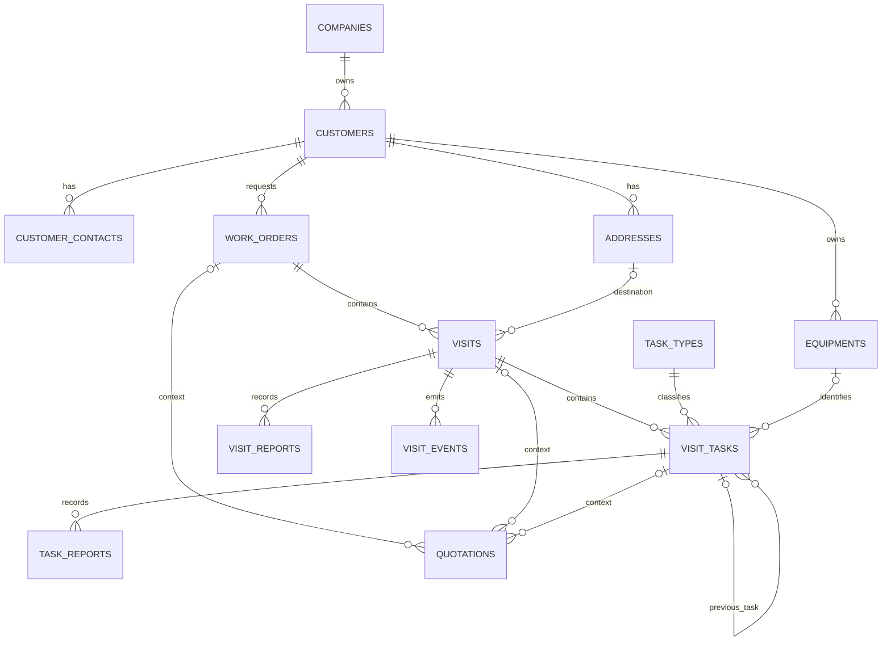
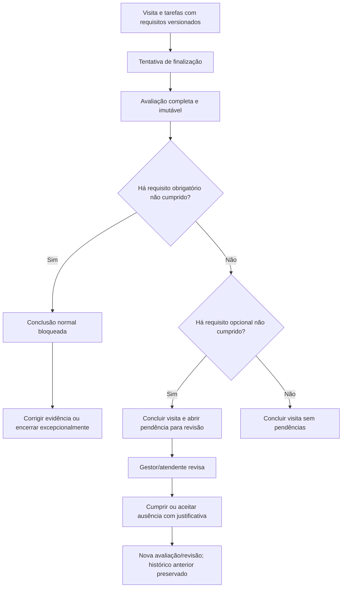
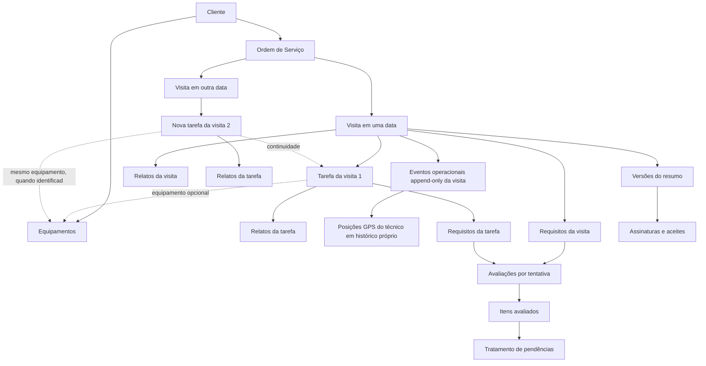

# Modelo lógico de dados e matriz de conformidade — Operação MVP

**Versão:** 0.6.0  
**Data:** 2026-11-08  
**Estado:** proposta técnica parcialmente aprovada como especificação; não aprovada como modelo físico  
**Projeto Supabase avaliado:** Winservice — `voaovwphncwbrwtcqnsc`  
**Schema:** `public`

> Este documento traduz o baseline funcional de Operação em uma proposta de modelo lógico e compara essa proposta com o schema efetivamente inspecionado. Não é uma ADR, não autoriza alterações no banco e não representa uma migração pronta para execução. Os nomes de tabelas e colunas propostos são conceituais até aprovação.

## 1. Objetivos e limites

O modelo deve:
- preservar a história completa de cada atendimento na Ordem de Serviço (OS);
- registrar cada comparecimento em uma visita própria;
- registrar tarefas específicas dentro de cada visita, sem status de execução ou conclusão na tarefa;
- relacionar opcionalmente cada tarefa a um equipamento identificado, ainda não identificado ou não aplicável;
- registrar relatos gerais da visita e relatos próprios de cada tarefa;
- registrar o ciclo operacional e os intervalos de execução por eventos append-only vinculados diretamente à visita, sem entidade de sessão;
- preservar autoria, versões anteriores e histórico de alterações;
- permitir navegação cliente → equipamento/OS → visita → tarefa → relatos e execução da visita;
- garantir coerência entre empresa, cliente, OS, visita, equipamento e usuários.

Fora do escopo desta proposta: DDL, migrações, políticas RLS, implementação de GPS no aplicativo, contratos de API, workflow n8n e definição completa de todos os estados de visita.

## 2. Decisões funcionais consideradas como entrada

1. A OS preserva o histórico completo do atendimento e pode conter várias visitas.
2. Uma nova data de atendimento gera uma nova visita. Em regra, a nova visita permanece na mesma OS; o técnico poderá optar por criar uma nova OS.
3. Cada visita possui suas próprias tarefas. Uma tarefa não é transferida para outra visita.
4. Se o atendimento continuar em outra data, cria-se nova visita e nova tarefa, normalmente vinculada ao mesmo equipamento e podendo referenciar a tarefa anterior.
5. A tarefa não possui status de execução ou conclusão.
6. Cada tipo de tarefa pode exigir campos, relatos e evidências próprios.
7. A visita precisa ter pelo menos um relato geral ou um relato de alguma tarefa antes de ser encerrada.
8. O equipamento da tarefa é opcional. Deve ser possível registrar equipamento ainda não identificado sem criar um equipamento fictício.
9. A visita é a única máquina de estados operacional. A execução temporal é reconstruída a partir de eventos append-only vinculados diretamente à visita; não existe entidade nem máquina de estados de sessão no MVP.
10. O técnico pode ter somente uma visita em execução por vez.
11. O início de uma nova visita finaliza a visita anterior, desde que o técnico registre o relato exigido para a finalização.
12. Ao se afastar 200 metros ou mais do endereço da visita (limiar configurável), a execução da visita é pausada automaticamente.
13. Ao retornar para 50 metros ou menos do endereço da visita (limiar configurável), a execução pausada pode ser retomada automaticamente, desde que a visita ainda esteja apta a continuar.
14. A regra anteriormente registrada de check-in inicial dentro de 50 metros por 5 minutos permanece como requisito a confirmar em conjunto com os novos limiares; não deve ser confundida com a regra de retomada.
15. O fim da jornada não encerra automaticamente a visita nem a execução. Ao tentar iniciar/check-in fora da jornada, o aplicativo solicita confirmação explícita ao técnico.
16. A visita finalizada automaticamente pode exigir relato posterior do técnico antes de ele prosseguir no aplicativo ou iniciar novo deslocamento/visita.
17. Estados terminais da visita não podem ser reabertos; a continuidade exige nova visita, que poderá permanecer vinculada à mesma OS.
18. Gestor pode editar visita finalizada. Edição por técnico e atendente é configurável pelo gestor.
19. Tipos de tarefa partem de um catálogo global, mas cada empresa poderá editar sua própria versão sem alterar o catálogo global nem as versões das demais empresas.
20. Um orçamento pode estar vinculado a, no máximo, uma entidade operacional: uma OS, uma visita, uma tarefa ou nenhuma delas.
21. A visita possui máquina de estados operacional própria, distinta da máquina reutilizável do módulo Chat. A Máquina B/sessões independentes foi eliminada do MVP por aprovação do responsável.
22. Alterações devem preservar dados anteriores e registrar autoria e temporalidade, conforme diretriz append-only aprovada na ADR-0016. A estrutura física permanece proposta.

## 3. Modelo conceitual e cardinalidades

O diagrama é conceitual. As relações opcionais e as restrições multiempresa devem ser formalizadas por chaves compostas e regras adicionais, não apenas pelo desenho.

### Cardinalidades principais

| Relação | Cardinalidade | Regra |
|---|---|---|
| Empresa → clientes | 1:N | Cliente pertence a uma empresa |
| Cliente → equipamentos | 1:N | Equipamento pertence a um cliente |
| Cliente → OS | 1:N | OS pertence a um cliente |
| OS → visitas | 1:N | Visita pertence a uma única OS |
| Visita → tarefas | 1:N | Tarefa pertence a uma única visita |
| Tipo de tarefa → tarefas | 1:N | Toda tarefa possui um tipo |
| Equipamento → tarefas | 1:N | Uma tarefa pode não ter equipamento |
| Tarefa → tarefa anterior | 0..1:N | Uma tarefa pode apontar para uma tarefa anterior; uma tarefa pode originar várias continuidades |
| Visita → relatos | 1:N | Relato geral é opcional individualmente; conjunto deve satisfazer regra mínima de encerramento |
| Tarefa → relatos | 1:N | Uma tarefa pode ter vários relatos |
| Visita → eventos operacionais | 1:N | Eventos append-only registram transições, início, pausas, retomadas, encerramento, revogação e GPS; não há entidade de sessão |
| OS/visita/tarefa → orçamento | 0..1:N | Cada orçamento pode apontar para no máximo uma dessas entidades, ou nenhuma |

## 4. Entidades lógicas propostas

Os nomes abaixo são sugestões. Não criar essas tabelas antes de aprovar o modelo e conferir convenções do projeto.

### 4.1 Entidades existentes a aproveitar conceitualmente

#### `customers` — clientes
Identidade do cliente e vínculo obrigatório com a empresa. Deve ser a origem do relacionamento com equipamentos e OS.

Campos relevantes existentes: `identifier`, `name`, `cpf_cnpj`, `status`, `created_by`, `updated_by`, `company_identifier`, `created_at`, `updated_at`.

Ajustes a avaliar:
- tornar `company_identifier` obrigatório após saneamento;
- garantir unicidade e coerência de identificadores dentro da empresa;
- revisar política RLS e FKs compostas.

#### `customer_contacts` — contatos
Preservar contatos associados ao cliente. Confirmar se telefone/e-mail serão normalizados nesta tabela ou em `phonenumbers`; evitar duplicidade de fonte de verdade.

#### `addresses` — endereços
Preservar cadastro de endereços do cliente. A visita deverá manter referência ao endereço e snapshot dos dados relevantes no momento do atendimento, incluindo endereço textual e coordenadas, para que alteração posterior do cadastro não reescreva o destino histórico.

#### `equipments` — equipamentos
Preservar o cadastro do equipamento vinculado ao cliente. Acrescentar autoria completa e vínculo multiempresa coerente. O equipamento poderá ser associado a tarefas diferentes em visitas e OS diferentes.

#### `work_orders` — ordens de serviço
Preservar a entidade como agregador histórico. O cliente deve ser obrigatório; empresa deve ser identificável e consistente com o cliente. A OS não deve ser reconstruída quando houver uma nova visita na mesma continuidade.

#### `visits` — visitas
Preservar a entidade de visita, mas revisar seu modelo. A relação canônica deve ser visita → OS → cliente → empresa. Se `customer_identifier` for mantido por desempenho ou consulta, precisa de constraint que garanta correspondência com o cliente da OS. Manter snapshot de endereço e responsável conforme necessário. Colunas únicas de check-in/checkout não substituem o histórico de múltiplos eventos.

### 4.2 Novas entidades propostas

#### `visit_tasks` — tarefas da visita

Uma linha representa uma atividade técnica específica registrada naquela visita.

Campos conceituais:
- `identifier` UUID PK;
- `company_identifier` UUID NOT NULL;
- `visit_identifier` UUID NOT NULL;
- `task_type_identifier` FK NOT NULL;
- `equipment_identifier` UUID NULL;
- `equipment_link_state` enum/text NOT NULL: `identified`, `unidentified`, `not_applicable`;
- `description` / `customer_request` para descrever a solicitação;
- `previous_task_identifier` UUID NULL para continuidade de outra visita;
- `sequence_number` para ordenação dentro da visita;
- `created_at`, `created_by`, `updated_at`, `updated_by`.

Restrições:
- não criar coluna `status` de execução/conclusão na tarefa;
- `identified` exige `equipment_identifier` preenchido;
- `unidentified` e `not_applicable` exigem `equipment_identifier` nulo;
- equipamento vinculado deve pertencer ao mesmo cliente e empresa da OS da visita;
- tarefa anterior deve pertencer ao mesmo cliente e empresa, mas pode estar em outra OS se o atendimento tiver sido separado;
- impedir autorreferência e ciclos na cadeia de tarefas anteriores;
- tipo de tarefa deve estar habilitado para a empresa no momento do registro.

**Distinção obrigatória:** `unidentified` significa que o cliente informou um equipamento, mas ainda não foi possível identificá-lo/cadastrá-lo. `not_applicable` significa que a atividade não depende de equipamento, por exemplo uma cobrança.

#### `task_type_requirements` — requisitos por tipo de tarefa

Define campos, relatos e evidências obrigatórios para cada tipo de tarefa. Campos conceituais:
- `identifier`;
- `company_identifier` ou referência ao escopo global/empresa do tipo;
- `task_type_identifier`;
- `requirement_code`;
- `requirement_kind` (campo, relato, foto, documento, assinatura etc.);
- `label`, `description`, `configuration` JSONB;
- `is_required`, `is_active`, `display_order`;
- autoria e temporalidade.

A configuração JSONB deve descrever validação e apresentação, mas não substituir colunas relacionais para dados críticos de negócio. Deve existir versionamento ou snapshot dos requisitos aplicados à tarefa, para que uma alteração futura no tipo não modifique retroativamente o que era obrigatório no momento do atendimento.

O requisito funcional está definido: haverá um catálogo global inicial e cada empresa poderá editar sua própria versão, sem afetar o catálogo global nem outras empresas. A estratégia física ainda deve escolher entre cópia sob demanda (copy-on-write), registros de personalização vinculados ao tipo global ou outra estrutura equivalente. Deve preservar a origem global, a versão herdada e o histórico de alterações. Uma edição local não pode alterar o tipo global nem propagar-se silenciosamente às empresas que já personalizaram o tipo.

#### `requirement_evaluations` — avaliações completas de requisitos

Uma avaliação é criada para cada tentativa de finalização normal da visita, inclusive quando a tentativa é bloqueada. A avaliação agrega os requisitos aplicáveis à visita e a todas as tarefas vinculadas, com instante, ator, contexto e resultado global. Não atualizar uma avaliação anterior quando houver nova tentativa.

Campos conceituais:
- `identifier`, `company_identifier`, `visit_identifier`;
- `attempt_number` ou sequência equivalente, com unicidade por visita;
- `requested_at`, `evaluated_at`, `recorded_at` (`timestamptz`);
- `requested_by`, `actor_kind`, origem/canal;
- `outcome`: por exemplo, `blocked_mandatory` ou `eligible_for_normal_completion`;
- referência ao snapshot/versão do conjunto de requisitos aplicáveis;
- correlation/idempotency identifier para impedir avaliações duplicadas por repetição da mesma solicitação.

#### `requirement_evaluation_items` — resultado por requisito

Um item por requisito avaliado em cada avaliação, com snapshot suficiente para reconstruir a regra aplicada.

Campos conceituais:
- `identifier`, `company_identifier`, `evaluation_identifier`;
- referência de origem ao requisito de visita ou de tipo de tarefa, mais tipo/identificador da entidade de contexto;
- código, descrição, tipo, obrigatoriedade e configuração em snapshot;
- `result`: `fulfilled`, `not_fulfilled` ou `not_applicable` quando permitido;
- referências às evidências/relatos que fundamentam o resultado;
- justificativa quando houver não aplicabilidade;
- timestamps e autoria do registro.

A avaliação deve cobrir requisitos da visita e de todas as tarefas, mesmo que a conclusão seja bloqueada por um único requisito obrigatório.

#### `requirement_pending_reviews` — tratamento de pendências

Registra o tratamento posterior sem alterar o resultado original da avaliação.

Estados conceituais: `pending_review`, `assigned_to_technician`, `fulfilled` e `accepted_with_justification`. O desenho pode evoluir, mas cada transição deve ser registrada append-only ou por eventos de revisão.

Campos conceituais:
- `identifier`, `company_identifier`, referência ao item de avaliação e à visita/tarefa;
- estado atual como projeção, origem e motivo da pendência;
- ator, data/hora, justificativa e decisão;
- referência a eventual evidência posterior e à avaliação subsequente.

Gestor e atendente autorizado podem aceitar a ausência de requisito opcional com justificativa. Técnico pode cumprir ou solicitar revisão, mas não dispensar. Requisito obrigatório pendente em encerramento excepcional deve ser encaminhado para revisão; a dispensa, se autorizada, não equivale a cumprimento. O histórico da avaliação original permanece intacto.

Os indicadores `has_pending_mandatory_requirements` e `has_pending_optional_requirements` na visita e na tarefa são projeções derivadas, não campos de entrada editáveis. Podem ser materializados para consulta, desde que sua origem e atualização sejam confiáveis e reconstruíveis.

#### `evidence_records` — evidências de visita e tarefa

Armazena a identidade e os metadados de fotografias, documentos e evidências de assinatura/aceite, vinculando cada item à visita ou tarefa e, quando aplicável, ao requisito que pretende satisfazer.

Campos conceituais:
- `identifier`, `company_identifier`, `visit_identifier` e/ou `task_identifier` com regra de exclusividade de contexto;
- `requirement_evaluation_item_identifier` ou referência ao requisito aplicável;
- `evidence_type`, nome original, MIME type, tamanho, hash/checksum e referência de armazenamento;
- `created_at` (`timestamptz`), `captured_at`, `received_at`, `upload_confirmed_at`;
- `latitude`, `longitude`, precisão, quando disponíveis e autorizadas;
- autor, dispositivo/origem, estado de validação e metadados técnicos.

`created_at` registra a criação/registro da evidência; `captured_at` registra o momento da captura no dispositivo; `received_at` e `upload_confirmed_at` distinguem recebimento e confirmação no backend. Latitude/longitude devem representar o local da captura/coleta, não o local da sincronização posterior. Todos os instantes devem usar tipo temporal com fuso, conceitualmente `timestamptz`.

#### `evidence_uploads` e `evidence_upload_attempts` — controle de envio

Separar o estado lógico da evidência do processo de transferência. Uma evidência pode estar localmente preparada, aguardando envio, enviando, aguardando retry, confirmada ou em falha/timeout.

Campos conceituais:
- identificador, empresa, evidência, chave idempotente;
- estado, número de tentativas, início, última tentativa, prazo/timeout e conclusão;
- erro classificado, resposta/recibo de armazenamento e checksum confirmado;
- tabela append-only de tentativas, quando necessária para preservar cada execução.

Timeout, quantidade máxima de retries, backoff, limites de tamanho e formatos ainda serão parametrizados. Repetições devem ser idempotentes. A evidência obrigatória só satisfaz requisito após confirmação de armazenamento/validação pelo backend. Upload obrigatório pendente ou não confirmado bloqueia conclusão normal; pode permanecer em andamento ou ser tratado por encerramento excepcional da visita. Em offline, o arquivo permanece em armazenamento local protegido até sincronização.

#### `acceptance_document_versions` — versões do resumo de visita

Representa cada versão imutável do resumo e seus anexos apresentados ao cliente.

Campos conceituais:
- `identifier`, `company_identifier`, `visit_identifier`;
- número/identificador de versão e estado;
- snapshot do conteúdo estruturado e renderizado, ou referência a artefato imutável;
- hash do resumo e referências/versões/hash dos anexos;
- `generated_at`, `presented_at`, autoria e origem;
- classificação de alterações relevantes/administrativas e referência à versão anterior.

O resumo principal inclui data/hora, cliente, equipamentos, técnico, solicitação original, relato geral e relatos das tarefas, fotografias incorporadas e valores discriminados da visita/tarefas. Documentos são anexos identificados, não incorporados como imagens no corpo do resumo. O cliente deve consultar resumo e anexos antes de assinar.

#### `digital_acceptances` — assinaturas e manifestações do cliente

Vincula a manifestação de vontade a uma versão exata de `acceptance_document_versions`.

Campos conceituais:
- `identifier`, `company_identifier`, `visit_identifier`, `acceptance_document_version_identifier`;
- signatário, método de identificação, dados estritamente necessários;
- modalidade `remote_customer_device` ou `in_person_technician_device`;
- referência/hash da assinatura e conteúdo aceito;
- `presented_at`, `signed_at`, `received_at`, `confirmed_at`;
- técnico responsável pela coleta presencial, canal/dispositivo e origem;
- latitude/longitude quando disponíveis e autorizadas;
- estado de sincronização/validação e cópia enviada ao cliente.

O link individual no dispositivo pessoal do cliente é a modalidade padrão. A assinatura no dispositivo do técnico é alternativa presencial. Offline, a coleta presencial pode ser armazenada localmente de forma protegida, mas só é confirmada pelo backend após sincronização e validação. Não coletar nem armazenar impressão digital. Data de nascimento é método de identificação considerado, mas o método inicial e os critérios de validação ainda não estão definidos; CPF não será exigido indiscriminadamente.

Alterações relevantes após assinatura exigem nova versão e novo aceite. Alterações administrativas sem impacto no conteúdo aceito não exigem nova assinatura. Versões, anexos, hashes e assinaturas anteriores permanecem preservados.

#### `acceptance_delivery_events` — envio de links e cópias

Opcionalmente, separar os eventos de emissão, envio, entrega, abertura e reenvio de links e de cópias ao cliente. Preservar canal, destinatário de forma minimizada, instante, resultado e identificador do provedor. Falha no envio da cópia não deve reescrever nem invalidar a assinatura já confirmada.

#### `visit_reports` — relatos gerais da visita

Campos conceituais:
- `identifier`, `company_identifier`, `visit_identifier`;
- `report_type`, `content`;
- `created_at`, `created_by`;
- referência à versão/formulário de relato, se aplicável.

Relatos devem ser append-only: correções geram novo registro ou revisão vinculada, sem sobrescrever o texto original.

#### `task_reports` — relatos da tarefa

Mesma lógica de `visit_reports`, com `task_identifier` obrigatório. Deve suportar relatos de orçamento, coleta, cobrança, retorno/garantia, vistoria e outros tipos. Os requisitos aplicáveis dependem do tipo da tarefa.

#### visit_events — eventos operacionais da visita

Registro append-only de todos os acontecimentos relevantes do ciclo operacional da visita. Esta entidade substitui as propostas anteriores de visit_execution_sessions e visit_execution_events; não haverá Máquina B nem estados independentes active, paused ou closed no MVP.

Campos conceituais:
- identifier, company_identifier, visit_identifier;
- event_type: tipo de evento de negócio, como status_changed, displacement_started, checkin, paused, resumed, checkout, authentication_revoked, prevented, interrupted, completed, canceled, gps_auto_pause e gps_auto_resume;
- previous_status, new_status, quando o evento representar transição;
- occurred_at: instante efetivo do acontecimento;
- recorded_at: instante em que o backend registrou o evento;
- latitude, longitude, accuracy_meters, quando disponíveis e aplicáveis;
- distance_from_visit_meters, quando calculável e confiável;
- source: manual, gps_automatic, system ou canal equivalente;
- actor_user_identifier e actor_kind, distinguindo humano, agente e sistema;
- reason e metadata para motivo e dados técnicos complementares;
- identificador de correlação/idempotência, quando necessário para impedir duplicidade.

Regras:
- O evento de transição e a atualização do estado atual da visita devem ser atômicos no backend/banco.
- Eventos não podem ser sobrescritos ou excluídos no fluxo operacional; correções geram novos eventos/revisões conforme ADR-0016.
- A ordem lógica considera o instante efetivo e preserva também o instante de recebimento; atrasos de sincronização offline não devem reescrever a sequência histórica.
- Pausas e retomadas são eventos da visita. Os intervalos de execução são projeções calculadas a partir dos eventos, não registros de sessão.
- A visita é a única fonte de estado operacional; não manter projeção de estado de sessão que possa divergir.
- A estrutura física, constraints, política de idempotência e estratégia de resolução de eventos fora de ordem ainda precisam ser definidas.

Os campos atuais de check-in/checkout e coordenadas em visits podem ser mantidos temporariamente como projeções/compatibilidade, mas a trilha completa deverá estar em eventos. Corrigir a grafia de chekin_at somente em migração planejada, com compatibilidade e atualização de consumidores.

#### `audit_events` — trilha geral de auditoria

Registro append-only obrigatório, conforme diretriz arquitetural aprovada, de alterações relevantes em OS, visitas, tarefas, equipamentos, relatos e sessões. Correções geram novos eventos/revisões, sem sobrescrever ou apagar eventos históricos.

Campos conceituais:
- `identifier`, `company_identifier`;
- `entity_type`, `entity_identifier`;
- `event_type`;
- `before_snapshot` JSONB, `after_snapshot` JSONB;
- `occurred_at`, `recorded_at`;
- `actor_user_identifier`, `actor_kind` (humano/agente/sistema);
- `source`, `reason`, `correlation_identifier`.

A referência polimórfica (`entity_type` + `entity_identifier`) não possui FK convencional para todas as tabelas. A integridade e a imutabilidade precisam ser garantidas por mecanismo confiável no backend/banco. Alternativa: tabelas de revisão específicas por entidade, se a exigência de FK for prioritária. Não conceder UPDATE/DELETE direto para papéis operacionais sobre eventos históricos.

#### `technician_gps_positions` — histórico de posições dos técnicos

Tabela append-only de amostras GPS recebidas dos dispositivos dos técnicos. Campos conceituais:
- `identifier`, `company_identifier`, `technician_user_identifier`;
- `latitude`, `longitude`, `accuracy_meters`;
- `captured_at`: instante informado pelo dispositivo para a captura;
- `received_at`: instante de recebimento pelo backend;
- `source`, `device_identifier` quando disponível;
- `metadata` técnico e identificador idempotente da amostra, quando disponível.

A posição mais recente é a última amostra válida recebida, acompanhada de idade e precisão. Em perda de sinal, a última posição permanece como referência histórica, não como prova da localização atual. Não produzir transições GPS automáticas usando amostra desatualizada. Frequência, retenção, particionamento e acesso precisam ser definidos considerando volume e sensibilidade dos dados.

#### Repositório de catálogos globais e versões — proposta lógica

Recomenda-se separar o catálogo global publicado da configuração efetivamente utilizada por cada empresa. Estruturas conceituais:
- `global_catalogs`: identidade e domínio do catálogo;
- `global_catalog_versions`: versões globais publicadas, imutáveis;
- `global_catalog_items`: itens de cada versão;
- `company_catalogs` e `company_catalog_items`: versão adotada e personalizações por empresa, com referência ao item e versão de origem;
- histórico de alterações e snapshots das personalizações.

A empresa edita apenas sua camada local. A plataforma publica novas versões globais sem modificar versões anteriores. A empresa escolhe quando atualizar; o processo deve mostrar diferenças, preservar personalizações e exigir resolução explícita de conflitos. Esta é uma recomendação para o modelo físico, não uma ADR aprovada. Deve suportar outros catálogos sem duplicar tabelas por domínio.

#### `quotations` — vínculo contextual exclusivo do orçamento

Regra funcional definida: cada orçamento pode estar associado a uma única entidade de contexto — OS, visita ou tarefa — ou não possuir vínculo operacional.

A proposta lógica é manter três FKs opcionais em `quotations` (`work_order_identifier`, `visit_identifier`, `task_identifier`) com uma constraint que permita zero ou apenas uma delas preenchida. Isso evita referência polimórfica sem FK e garante exclusividade do vínculo. A alternativa de uma tabela de vínculo polimórfica não é preferida por perder integridade referencial convencional.

Implicações:
- orçamento vinculado à OS não precisa também preencher visita ou tarefa;
- orçamento vinculado à visita não precisa preencher OS ou tarefa, embora a visita pertença a uma OS;
- orçamento vinculado à tarefa não precisa preencher visita ou OS, embora a tarefa pertença a uma visita e OS;
- orçamento sem vínculo mantém os três campos nulos;
- a coerência de empresa/cliente deve ser garantida por FKs compostas/validações transacionais;
- o schema atual possui vínculos com OS e visita; a migração deverá resolver registros existentes que hoje preencham ambos, sem presumir qual vínculo deve prevalecer.

Não haverá relação N:M `quotation_tasks` neste desenho inicial. Caso surja requisito de um orçamento abranger várias tarefas, isso será uma mudança explícita de modelo.

### 4.3 Entidades existentes que exigem decisão

#### `work_order_equipment`

Não representa tarefa e não deve ser adaptada para isso. Pode continuar como associação de equipamentos abrangidos pela OS, se houver utilidade administrativa independente. Se a relação OS-equipamento puder ser totalmente derivada das tarefas, a tabela pode ser redundante e deverá ser avaliada antes de mantê-la.

Os defaults atuais `gen_random_uuid()` em `created_by`, `last_updated_by`, `work_order_identifier` e `equipment_identifier` são suspeitos: geram UUIDs sem correspondência garantida com usuários/entidades. Corrigir somente após revisar dados, constraints e consumidores.

#### `task_types`

Aproveitar como catálogo inicial, mas revisar:
- chave atual `id` é integer, não UUID;
- `name` e `code` aceitam NULL;
- não foi observada coluna de empresa/escopo, versão ou configuração de obrigatoriedades;
- autoria usa `last_updated_by`, diferente da convenção geral `updated_by`.

Não migrar o identificador sem necessidade. É possível manter integer como PK do catálogo e usar FK correspondente em `visit_tasks`, desde que a estratégia de catálogo global/empresa seja decidida.

## 5. Regras de integridade e constraints

### 5.1 Identidade e chaves

- Manter UUID `identifier` como chave pública/relacional de domínio onde já é convenção.
- Não confundir PK técnica bigint `id` com identificador de domínio UUID.
- Para tabelas multiempresa, usar `company_identifier NOT NULL` após saneamento.
- Criar unicidade composta `(identifier, company_identifier)` onde necessária para FKs compostas.
- Evitar referências independentes que permitam combinar registros de empresas ou clientes diferentes.

### 5.2 Coerência entre cliente, OS, visita, tarefa e equipamento

A cadeia canônica recomendada é:
- `work_orders`: `(identifier, company_identifier, customer_identifier)`;
- `visits`: `(identifier, company_identifier, work_order_identifier)`;
- `visit_tasks`: `(identifier, company_identifier, visit_identifier, equipment_identifier)`;
- `visit_events`: `(identifier, company_identifier, visit_identifier)`;
- `equipments`: `(identifier, company_identifier, customer_identifier)`;
- `quotations`: vínculo opcional exclusivo a OS, visita ou tarefa, sempre na mesma empresa e contexto de cliente.

Constraints compostas devem impedir:
- visita ligada a OS de outra empresa;
- equipamento de outro cliente/empresa associado à tarefa;
- tarefa anterior de outro cliente/empresa;
- relato ou evento associado a registro de outro tenant.

O cliente da visita deve ser herdado da OS como fonte canônica. Se a coluna `visits.customer_identifier` for mantida por compatibilidade, precisa ser validada contra `work_orders.customer_identifier`.

### 5.3 Autoria

Todos os registros de negócio devem identificar criador e última alteração, quando mutáveis:
- `created_at`, `created_by`;
- `updated_at`, `updated_by`.

Eventos e relatos append-only identificam autor e horário de criação; não precisam de `updated_by` se não puderem ser editados. O ator deve distinguir humano, agente autônomo e sistema. O usuário que configurou um agente não substitui a identidade do agente que executou a operação.

### 5.4 Relatos e encerramento de visita

A regra “visita precisa de pelo menos um relato geral ou de tarefa” envolve mais de uma tabela. Um simples CHECK constraint não consegue validar diretamente registros em outras tabelas. Recomenda-se:
- validar atomicamente no serviço/backend de finalização;
- complementar com função/trigger transacional no banco, se a regra precisar ser inviolável em todos os caminhos;
- impedir encerramento se não existir ao menos um relato válido associado à visita ou a uma tarefa dela.

### 5.5 Exclusividade de visita por técnico

A regra de uma visita não terminal por técnico precisa de garantia transacional no backend e constraint/índice no banco. Estados considerados operacionais: in_displacement, in_progress e paused; uma visita pausada continua ocupando a disponibilidade. A forma exata depende do desenho físico. Alternativas:
- índice único parcial sobre `responsible_id` para os estados de visita considerados ativos; ou
- tabela de alocação/claim ativo com uma linha única por técnico e referência à visita.

Os estados que ocupam a exclusividade são in_displacement, in_progress e paused. O início de nova visita deve disputar a mesma exclusividade, sem janela de concorrência.

### 5.6 Execução da visita e GPS

A visita é a única máquina de estados operacional. Não haverá tabela visit_execution_sessions, tabela visit_execution_events nem Máquina B no MVP. Todos os eventos operacionais e temporais serão registrados diretamente em visit_events.

- Estados da visita: pending, in_displacement, in_progress, paused, completed, interrupted, prevented, canceled.
- Transições: pending → in_displacement, in_progress, prevented, canceled; in_displacement → pending, in_progress, prevented, canceled; in_progress → paused, completed, interrupted; paused → in_progress, interrupted.
- completed, interrupted, prevented e canceled são terminais.
- prevented representa impedimento antes do início; interrupted representa encerramento excepcional depois do início.
- Revogação de autenticação: pending permanece; in_displacement retorna para pending; in_progress e paused vão para interrupted; estados terminais permanecem.
- O fim da jornada não encerra automaticamente visita ou execução. Tentativa de início/check-in fora da jornada exige confirmação do técnico.
- Um técnico só pode executar uma visita por vez; visita pausada mantém a exclusividade.
- Check-in inicial automático: 5 minutos dentro de 50 metros, ambos configuráveis; funcionalidade futura fora do MVP.
- Afastamento de 200 metros ou mais pode pausar automaticamente; retorno a 50 metros ou menos pode retomar automaticamente, ambos configuráveis. A automação deve ser idempotente.
- Amostra GPS inicialmente aceita com incerteza reportada de até 50 metros, configurável. Em perda de sinal, usar a última posição recebida apenas como referência histórica, preservando sua idade; não disparar transição com posição obsoleta.
- Posições de técnicos permanecem em entidade própria technician_gps_positions, separadas dos eventos de transição da visita.
- visit_events preserva estado anterior/posterior, instante efetivo, instante de registro, ator, origem, motivo e GPS quando aplicável.
- Duração total, intervalos ativos e pausas são calculados como projeções dos eventos; não se cria sessão para armazená-los.
- Mudança de estado e evento correspondente devem ser confirmados atomicamente. Requisições concorrentes, eventos duplicados e sincronização offline exigem idempotência e política explícita de ordenação.
- Detalhes de autenticação (logout voluntário, expiração e revogação administrativa), motivos padronizados, parâmetros GPS e jornada ainda exigem especificação complementar.

### 5.7 Avaliações, evidências e conclusão da visita

- Cada tentativa de finalização normal deve criar uma avaliação completa e imutável, com um item por requisito aplicável da visita e de todas as tarefas.
- A conclusão normal é bloqueada se houver requisito obrigatório não cumprido ou evidência obrigatória sem upload confirmado pelo backend.
- Requisitos opcionais não cumpridos geram pendência e não bloqueiam conclusão normal.
- Encerramento excepcional por interrupção/abandono pode ocorrer com requisitos obrigatórios pendentes; não deve ser classificado como conclusão normal. A pendência permanece para revisão autorizada.
- Dispensa justificada não muda o resultado original para `fulfilled`; registra decisão separada, ator, instante e justificativa.
- Indicadores de requisitos obrigatórios/opcionais pendentes na visita e na tarefa são projeções derivadas das avaliações e dos tratamentos.
- Evidência deve ter vínculo íntegro e exclusivo ao contexto (visita ou tarefa) e, quando aplicável, ao requisito.
- Uma evidência só satisfaz requisito após confirmação de armazenamento e validação pelo backend. O estado local ou a mera captura não basta.
- Uploads devem ser idempotentes; tentativas e retries precisam ser registráveis sem duplicar evidência.
- Assinatura digital deve apontar para uma versão imutável do resumo e anexos, identificada por hash. Alteração relevante exige nova versão e novo aceite.
- A coleta offline permanece provisória até sincronização e confirmação pelo backend.

## 6. Diagrama de fluxo do histórico

## 7. Matriz de conformidade com o Supabase atual

**Base de evidência:** inspeção somente leitura da listagem de tabelas, colunas, PKs e FKs do schema `public`, realizada em 2026-11-08. A classificação não substitui consulta de dados, policies, funções, triggers, código cliente ou testes.

Legenda:
- **Aproveitar:** estrutura conceitualmente alinhada, sujeita a validações.
- **Ajustar:** estrutura existe, mas precisa de alteração/fortalecimento.
- **Criar:** não foi encontrada estrutura dedicada ao requisito.
- **Revisar:** utilidade, redundância ou integridade ainda não determinada.

| Requisito/entidade lógica | Objeto atual | Evidência observada | Ação proposta | Prioridade |
|---|---|---|---|---|
| Cliente | `customers` | UUID `identifier`, dados cadastrais, `company_identifier`, autoria | Aproveitar; sanear obrigatoriedade e integridade multiempresa | P0 |
| Contatos | `customer_contacts`, `phonenumbers` | Duas estruturas de contato/telefone | Revisar sobreposição e definir fonte canônica; completar autoria | P1 |
| Endereços | `addresses` | Cliente, empresa, coordenadas, autoria | Aproveitar; constraints compostas e corrigir fluxo de snapshot de visita | P0 |
| Equipamentos | `equipments` | Cliente, tipo, fabricante, modelo, série; sem empresa/autoria visível | Ajustar: empresa derivada/garantida pelo cliente ou coluna própria; autoria e unicidade | P0 |
| OS | `work_orders` | UUID, status, cliente; sem empresa/autoria visível; FK cliente | Ajustar: cliente obrigatório, empresa, autoria, integridade e regras de status | P0 |
| Visitas | `visits` | OS, cliente, status, responsável, endereço, GPS e timestamps únicos | Ajustar: coerência cliente/OS, snapshots, autoria e ciclo de eventos | P0 |
| Tarefas por visita | Nenhuma tabela dedicada encontrada | Existe catálogo `task_types`, mas não entidade de instância | Criar `visit_tasks` | P0 |
| Tipos de tarefa | `task_types` | `id` integer, `name`/`code` nullable, autoria parcial | Aproveitar e ajustar; catálogo global com personalização independente por empresa e versionamento | P0 |
| Requisitos por tipo de tarefa | Nenhuma estrutura dedicada encontrada | `visit_requirements` relaciona-se a `visit_types`, não `task_types` | Criar `task_type_requirements` e snapshot/versionamento | P1 |
| Equipamento não identificado/não aplicável | Nenhuma representação dedicada encontrada | `visit_tasks` não existe; equipamento só é ligado a cliente/OS | Criar estado de associação na tarefa + equipamento opcional | P0 |
| Continuidade entre tarefas de visitas distintas | Nenhuma relação encontrada | Sem entidade tarefa | Criar FK opcional `previous_task_identifier` em `visit_tasks` | P1 |
| Relatos gerais da visita | Nenhuma tabela dedicada encontrada | `visits` não tem relato estruturado observado | Criar `visit_reports` | P0 |
| Relatos por tarefa | Nenhuma tabela dedicada encontrada | Não há instância de tarefa nem relatório | Criar `task_reports` | P0 |
| Avaliações de requisitos | Nenhuma estrutura dedicada encontrada | Não há histórico de tentativas/resultados por requisito | Criar `requirement_evaluations` e `requirement_evaluation_items` append-only | P0 |
| Pendências e revisão | Nenhuma estrutura dedicada encontrada | Não há tratamento auditável de requisito não cumprido | Criar `requirement_pending_reviews` ou eventos equivalentes | P0 |
| Evidências e uploads | `documents` genérico; sem fluxo dedicado comprovado | Não há vínculo estruturado a requisito, tentativa, upload, retry e confirmação | Criar/ajustar `evidence_records`, `evidence_uploads` e tentativas | P0 |
| Aceite digital | `approval_events` e `documents` existem, mas não comprovam o fluxo especificado | Não há versão imutável do resumo nem assinatura vinculada à versão comprovada | Criar `acceptance_document_versions`, `digital_acceptances` e eventos de entrega | P1 |
| Eventos operacionais da visita | Nenhuma tabela dedicada encontrada | `visits` possui um único conjunto de check-in/checkout, insuficiente para a trilha append-only | Criar `visit_events` com eventos de estado, execução e GPS | P0 |
| Histórico de posições GPS | Nenhuma tabela dedicada encontrada | `visits` mantém apenas coordenadas pontuais | Criar `technician_gps_positions` append-only, com captura/recebimento/precisão | P0 |
| Eventos do ciclo da visita | Nenhuma tabela dedicada encontrada | Colunas atuais armazenam poucos marcos | Criar `visit_events`; manter colunas atuais como projeção temporária | P0 |
| Auditoria de alterações | Nenhuma trilha append-only dedicada encontrada | Campos created/updated em algumas tabelas | Criar `audit_events` e/ou revisões por entidade; append-only obrigatório | P0 |
| Associação OS-equipamento | `work_order_equipment` | Associação simples; defaults UUID suspeitos em FKs e autoria | Revisar; não usar como tarefa; corrigir defaults ou descontinuar após análise | P1 |
| Orçamentos | `quotations` | Relaciona OS, cliente e visita | Ajustar para vínculo opcional exclusivo: OS OU visita OU tarefa OU nenhum; sanear vínculos simultâneos existentes | P1 |
| Eventos de aprovação | `approval_events` | Evento, versão, hash, decisão e referências a orçamento/OS/cliente | Aproveitar; garantir consistência empresa e vincular versão/escopo da tarefa quando aplicável | P1 |
| Documentos/evidências | `documents` | Metadados e uploader, sem vínculo operacional direto observado | Criar relação explícita de documentos com visita/tarefa; não usar referência polimórfica sem integridade | P1 |
| Autoria uniforme | Diversas tabelas | Autoria ausente em equipamentos, OS, telefones e orçamento; padrões divergentes | Ajustar convenção e garantir identidade de humano/agente/sistema | P0 |
| Isolamento multiempresa | Várias tabelas | Auditoria anterior encontrou RLS/policies e FKs com riscos | Corrigir desenho de tenancy, FKs compostas, RLS e testes antes de produção | P0 |

### 7.1 Notas específicas sobre objetos atuais

- `work_order_equipment` não pode ser reaproveitada como entidade de tarefa. A tarefa precisa pertencer a uma visita e ter tipo, relatos, eventos relacionados e vínculo opcional a equipamento.
- `task_types` é catálogo, não registro de tarefa executada.
- O catálogo global deve ser versionado e separado das personalizações locais das empresas; uma atualização global não pode sobrescrever personalizações.
- `visit_types` e `visit_type_requirement` descrevem tipo/requisitos de visita; não substituem requisitos de tarefa.
- `documents` pode continuar como repositório de metadados de arquivos, mas precisa de uma relação explícita e segura com a entidade operacional correspondente.
- `quotations` já tem FKs para OS e visita. O modelo funcional agora exige vínculo exclusivo e opcional com OS, visita ou tarefa; a migração precisa tratar os registros atuais com mais de um vínculo preenchido.
- `approval_events` contém `created_by` apontando a `auth.users.id`, enquanto outras entidades apontam a `public.users.identifier`. Essa diferença de identidade deve ser normalizada/documentada antes de expandir auditoria.

## 8. Ordem recomendada de implementação (ainda não autorizada)

1. **Fundação e integridade:** definir tenancy, chaves compostas, autoria, convenções de UUID, RLS e regras de acesso.
2. **Núcleo operacional:** ajustar `customers`, `addresses`, `equipments`, `work_orders` e `visits`.
3. **Tarefas e catálogo:** `visit_tasks`, escopo/versionamento de `task_types` e requisitos por tipo.
4. **Relatos e evidências:** `visit_reports`, `task_reports`, vínculo de documentos e regra de encerramento com relato.
5. **Execução e GPS:** eventos append-only da visita, histórico de posições dos técnicos, idempotência, exclusividade, pausa/retomada e finalização por transição/jornada.
6. **Histórico e auditoria:** snapshots, eventos imutáveis e revisões, autoria de humano/agente/sistema.
7. **Comercial:** vínculo exclusivo opcional de orçamento a OS, visita ou tarefa, versões e aprovação.
8. **Migração e testes:** plano de migração de dados, constraints, RLS, concorrência, GPS simulado, falhas offline e regressão.

Não executar essa sequência sem aprovação do modelo físico, plano de migração e testes.

## 8.1 Especificação técnica aprovada — eventos e sincronização offline (2026-11-08)

**Estado:** especificação técnica aprovada pelo responsável; implementação física ainda não autorizada.

### Estrutura conceitual de `visit_events`

Cada linha representa um acontecimento operacional efetivamente aceito pelo servidor. Campos propostos:

- `identifier uuid`, `company_identifier uuid`, `visit_identifier uuid`;
- `sequence_number bigint`, atribuído pelo servidor em sequência por visita;
- `event_type text`, `previous_status text`, `new_status text`;
- `occurred_at timestamptz` (instante informado como ocorrência no dispositivo/origem) e `recorded_at timestamptz` (instante oficial de registro no servidor);
- `actor_kind` (`human`, `agent`, `system`), `actor_user_identifier uuid` quando aplicável;
- `source`, `reason_code`, `description`;
- `latitude`, `longitude`, `accuracy_meters`, `distance_from_visit_meters`, quando aplicáveis;
- `idempotency_key`, `correlation_identifier`, `device_identifier`, `metadata jsonb`.

Restrições e índices a implementar após validação física:
- PK em `identifier`; FKs para empresa e visita, com integridade composta que impeça associação cruzada entre empresas;
- unicidade de `(visit_identifier, sequence_number)`;
- unicidade da chave idempotente no escopo da empresa/visita;
- CHECKs para tipos, estados, coerência de coordenadas e campos obrigatórios de transição;
- índices para histórico por visita/sequência e consulta por empresa/período;
- bloqueio de UPDATE/DELETE no fluxo operacional, conforme ADR-0016.

A atualização do estado da visita e a inclusão do evento devem ocorrer na mesma transação. O servidor serializa a sequência por visita e aplica a validação de transição contra o estado efetivamente persistido.

### Exclusividade do técnico

Os estados `in_displacement`, `in_progress` e `paused` ocupam a disponibilidade do técnico. `pending` e estados terminais não ocupam. A regra é global por identidade do técnico, inclusive quando ele estiver associado a mais de uma empresa.

A implementação deverá combinar serialização transacional por técnico com uma restrição única parcial no conjunto de visitas ativas. A troca de responsável de visita ativa também deverá passar por operação transacional validada; não poderá contornar a exclusividade por UPDATE direto.

### Sincronização offline e relógio do dispositivo

- O dispositivo preserva identificador idempotente da operação, `occurred_at`, tipo do evento e contexto observado.
- O servidor define `recorded_at`, valida autorização, empresa, idempotência, estado atual e transição; gera `sequence_number`; grava evento e estado atomicamente.
- Repetições idempotentes retornam o resultado original. Eventos incompatíveis com o estado atual não sobrescrevem nem são aplicados retroativamente; retornam conflito para tratamento.
- `occurred_at` e `recorded_at` são preservados separadamente.
- Antes de disponibilizar uma nova visita recebida ao técnico, o aplicativo compara o relógio do dispositivo com o horário oficial do ERP/servidor. Se houver diferença, apresenta aviso ao usuário; a divergência, isoladamente, não bloqueia a disponibilização. O horário do servidor é a referência para `recorded_at`.
- O aviso de divergência não torna confiável, por si só, o relógio do dispositivo; a reconciliação continua sendo responsabilidade do servidor.

### Comandos rejeitados e autorização de revisão

`visit_events` contém somente eventos canônicos aceitos. Comandos offline recebidos e rejeitados/conflitantes devem ser auditados separadamente, em estrutura própria proposta (por exemplo, `visit_event_sync_attempts`), com chave idempotente, empresa/visita quando identificáveis, dispositivo, horários, conteúdo mínimo necessário e motivo/resultado da validação. Essa estrutura não representa o comando rejeitado como acontecimento operacional.

A revisão e eventual resolução de eventos antigos ou conflitantes fica restrita a gestores e atendentes/usuários expressamente autorizados. Técnicos não podem aprovar, dispensar ou reclassificar conflitos.

### Idade dos eventos offline — recomendação ainda não aprovada

Recomenda-se que a idade do evento não seja critério isolado de rejeição. A validação deve considerar também sequência, estado atual, identidade/origem e consistência temporal. Como ponto de partida para discussão, recomenda-se janela configurável de até 24 horas para reconciliação automática quando todos os demais critérios forem satisfeitos; eventos mais antigos seriam encaminhados à revisão autorizada. **O limite de 24 horas permanece pendente de aprovação explícita** e não deve ser implementado como regra vigente.

### Pré-condições obrigatórias

A implementação de `visit_events` depende da correção e validação de tenancy, chaves compostas, RLS e autorização multiempresa. Também depende da correção/teste da função de snapshot de endereço e das inconsistências atuais de `visits` identificadas na auditoria. A aprovação desta especificação não autoriza DDL, migrações ou alterações no Supabase.

## 9. Decisões e perguntas ainda abertas

1. **Requisitos dinâmicos por tipo:** quais tipos de campos serão suportados inicialmente (texto, seleção, número, data, foto, documento, assinatura etc.) e como serão versionados?
2. **Equipamento indefinido:** confirmar formalmente os três valores propostos: identificado, não identificado e não aplicável.
3. **Check-in inicial automático:** funcionalidade futura fora do MVP; manter como parâmetro inicial 5 minutos dentro de 50 metros, ambos configuráveis.
4. **GPS:** definir frequência de amostragem, idade máxima operacional, retenção, localização simulada/antifraude e tratamento de leituras inconsistentes.
5. **Jornada:** definir horário, fuso, dias úteis e regra de confirmação para início/check-in fora da jornada. O fim da jornada não encerra automaticamente visita ou execução.
6. **Visita:** estados e transições operacionais foram definidos no modelo funcional. Permanecem a especificação física, validação transacional e enforcement da exclusividade por técnico. Tarefas não têm início individual nem estados.
7. **Relato de transição:** definir status de destino, motivos padronizados e tratamento quando o técnico não consegue registrar o relato imediatamente.
8. **Auditoria imutável:** detalhar retenção, correções, proteção contra UPDATE/DELETE e estratégia de integridade, conforme ADR-0016 aprovada.
9. **Documentos:** definir relação e armazenamento de fotos/documentos por tarefa e visita.
10. **Identidade:** normalizar referências de autoria para usuário humano, agente autônomo e sistema.
11. **Catálogos globais:** aprovar ou ajustar o repositório versionado e a política de atualização/merge das personalizações.
12. **Uploads:** definir timeout, retries máximos, backoff, tamanho/formato de arquivos, retenção, política de limpeza local e confirmação de integridade no storage.
13. **Identificação do signatário:** escolher método inicial, critérios de validação, contingência para cadastro incompleto e proteção/expiração dos links.
14. **Aceite digital:** definir eventos de apresentação/ciência/aceite/consentimento, validade do link, reenvio, revogação e classificação completa de alterações relevantes.
15. **Pendências obrigatórias:** definir matriz de autorização para dispensa justificada após encerramento excepcional, sem confundir dispensa com cumprimento.
16. **Resumo de visita:** definir layout final, regra para valores/tributos/descontos, campos opcionais e tratamento de visitas sem equipamento.

## 10. Riscos e pré-condições antes de DDL

- A auditoria técnica de 2026-11-07 encontrou policies RLS permissivas sem filtro por empresa em entidades relevantes, grants amplos e problemas de integridade multiempresa. Esses pontos precisam ser tratados antes de expor o novo modelo.
- A função `set_visit_address_snapshot` foi identificada na auditoria anterior como incompatível com colunas existentes em `addresses`; corrigir e testar antes de depender do snapshot.
- Os defaults `gen_random_uuid()` em FKs de `work_order_equipment` e campos de autoria são suspeitos e devem ser investigados.
- O schema consultado é estado observado em 2026-11-08; não foram inspecionados dados de produção, código de aplicação, workflows, políticas novamente nesta etapa ou testes de comportamento.
- As tabelas propostas não devem ser criadas até fechar as decisões pendentes, especialmente tenancy, requisitos dinâmicos, estrutura física de visit_events, GPS, jornada e desenho físico de auditoria.
- A diretriz append-only está aprovada; a estrutura física e os controles técnicos ainda não estão aprovados.
- A proposta de repositório de catálogos globais versionados com camada local por empresa permanece pendente de aprovação.
- O padrão append-only foi aprovado como diretriz arquitetural; implementação, retenção, proteção contra adulteração e mecanismo de revisão ainda precisam ser projetados.
- A definição de tipos globais editáveis por empresa e o vínculo exclusivo opcional de orçamento já foram recebidos como requisitos funcionais, mas a estratégia física ainda não está aprovada.

## 11. Evidência e limites da inspeção

- Inspeção de metadados de tabelas, colunas, PKs e FKs do schema `public`, em 2026-11-08.
- Nenhuma consulta de conteúdo pessoal de clientes foi executada.
- Nenhum DDL, DML, policy, função, trigger, migration, configuração ou dado foi alterado.
- Não foram executados testes de RLS, GPS, concorrência, workflows, API ou aplicativo.
- A matriz é uma avaliação de conformidade estrutural, não um relatório de teste de execução.

## Histórico de alterações

- 2026-11-08 — v0.6.0: especificação técnica aprovada de visit_events, transação atômica estado/evento, exclusividade global do técnico, sincronização offline com occurred_at/recorded_at, comparação do relógio do dispositivo com o horário oficial e trilha separada para comandos rejeitados; tenancy e RLS registrados como pré-condições. Janela de 24 horas permanece apenas recomendação pendente.

- 2026-11-08 — v0.5.0: remoção da Máquina B e das entidades de sessão; unificação dos eventos operacionais/temporais diretamente em visit_events; inclusão da Máquina A aprovada, transições por revogação e jornada sem encerramento automático; revisão de cardinalidades, integridade e perguntas abertas.
- 2026-11-08 — v0.4.0: inclusão das avaliações históricas por tentativa, pendências obrigatórias/opcionais, tratamento por gestor/atendente, evidências com uploads idempotentes e confirmação no backend, metadados temporais/GPS e proposta lógica de resumo/aceite digital versionado com coleta remota, presencial e offline.
- 2026-11-08 — v0.3.0: inclusão do histórico GPS de técnicos, precisão configurável de até 50 m, posição mais recente sem inferência a partir de amostra obsoleta, gatilhos de finalização por deslocamento/fim de jornada; tarefas não possuem início individual, confirmação do check-in inicial e aprovação da diretriz append-only; detalhada proposta de repositório global de catálogos versionados.
- 2026-11-08 — v0.2.0: revisão após decisões funcionais sobre catálogo global editável por empresa, vínculo exclusivo opcional de orçamento, execução/sessões no nível da visita, limiares GPS de pausa/retomada e transição entre visitas. Removidas sessões de tarefa; máquina de estados do módulo Chat mantida separada.
- 2026-11-08 — v0.1.0: criação do modelo lógico proposto e matriz de conformidade inicial com o schema Supabase.
